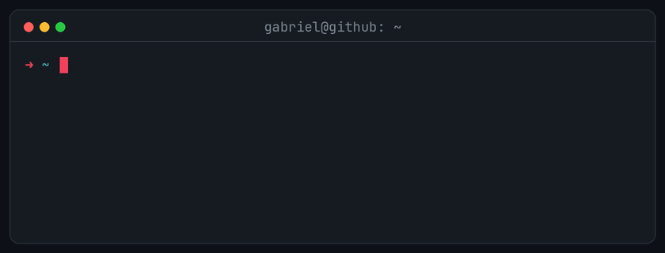

  
  
  
  

Português · <a href="#english">English below</a>

##  Sobre mim

Sou o **Gabriel Pinto Machado**, desenvolvedor full-stack em **Porto Alegre, RS**, e estudo **Ciência da Computação na Estácio**.
Construo apps web e mobile e sistemas em tempo real, do modelo de dados à última animação. Gosto de problemas em que várias telas precisam concordar no mesmo instante.

-  Hoje: o **Financy** (finanças pessoais com Open Finance) e o **Órbita** (organização pessoal para iPhone)
-  Aberto a vagas CLT ou PJ, presencial em Porto Alegre ou remoto, e a projetos
-  O caminho mais rápido: [gabriel.pmachado00@gmail.com](mailto:gabriel.pmachado00@gmail.com)

<b>Como eu trabalho</b> (clique para abrir)

 

- **Estrutura antes de tudo:** camadas bem separadas, regras de acesso testadas e um projeto que outra pessoa consegue abrir e entender.
- **Fluxos que guiam:** etapas, confirmações e atalhos no lugar de formulários enormes. A interface conduz, o usuário não decora.
- **Nada de bagunça:** estado em um só lugar, dados sincronizados entre telas e nada sobrando quando ninguém usa.

##  Tecnologias

  
  
  
  
  
  
  
  
  
  
  
  

##  Projetos em destaque

| Projeto | O que é | Stack | Link |
|---|---|---|---|
|  **Financy** | Finanças pessoais na web, no iPhone e no Android, com Nubank e Mercado Pago entrando sozinhos via Open Finance | React 19 · Firebase · Kotlin | [Ver ao vivo](https://financy-vert.vercel.app) |
|  **Órbita** | Organização pessoal com módulos que ligam e desligam, captura em linguagem natural e Liquid Glass do iOS 26 | React Native · Expo · Swift | [Código](https://github.com/GabrielPMachado/Orbita) |
|  **HypeApp** | O "Waze do Rolê": o hype de cada bar da Cidade Baixa em tempo real, com nota de 0 a 10 de quem está lá | React Native · Firebase · Google Maps | [Código](https://github.com/GabrielPMachado/HypeApp) |
|  **Bar do Dindo** | App de fidelidade, CRM da equipe e pré-cadastro de um bar, tudo num projeto Firebase sem servidor próprio | TypeScript · Firestore · Capacitor | [Código](https://github.com/GabrielPMachado/BarDoDindo) |
|  **O Vértice** | SaaS para pequenas empresas: presença online, marketing e planejamento, com carrossel 3D de templates | React 19 · Vite · Vitest | [Ver ao vivo](https://overtice.vercel.app) |

Todos com demo animada no <a href="https://portfolio-financy1.vercel.app">portfólio</a>.

##  Contribuições

<picture>
  <source media="(prefers-color-scheme: dark)" srcset="assets/contribuicoes.svg" />
  <source media="(prefers-color-scheme: light)" srcset="assets/contribuicoes-claro.svg" />
  
</picture>

---

<h2> English</h2>

###  About me

I'm **Gabriel Pinto Machado**, a full-stack developer in **Porto Alegre, Brazil**, studying **Computer Science at Estácio**.
I build web and mobile apps and real-time systems, from the data model to the last animation. I enjoy problems where several screens have to agree at the same moment.

-  Currently: **Financy** (personal finance with Open Finance) and **Órbita** (personal organizer for iPhone)
-  Open to full-time or contract roles, on-site in Porto Alegre or remote, and to freelance projects
-  Fastest way to reach me: [gabriel.pmachado00@gmail.com](mailto:gabriel.pmachado00@gmail.com)

<b>How I work</b> (click to open)

 

- **Structure first:** well-separated layers, tested access rules and a project someone else can open and understand.
- **Flows that guide:** steps, confirmations and shortcuts instead of huge forms. The interface leads, the user doesn't have to memorize.
- **No mess:** state in one place, data synced across screens and nothing left running when nobody is using it.

###  Tech stack

TypeScript · React · React Native · Expo · Node.js · Firebase · Kotlin · Python · Vite · Tailwind · Capacitor · GitHub Actions

###  Featured projects

| Project | What it is | Stack | Link |
|---|---|---|---|
|  **Financy** | Personal finance on web, iPhone and Android, with bank transactions flowing in through Open Finance | React 19 · Firebase · Kotlin | [Live](https://financy-vert.vercel.app) |
|  **Órbita** | Modular personal organizer with natural-language capture and iOS 26 Liquid Glass | React Native · Expo · Swift | [Code](https://github.com/GabrielPMachado/Orbita) |
|  **HypeApp** | Real-time "hype" score for every bar in Cidade Baixa, rated by the people already there | React Native · Firebase · Google Maps | [Code](https://github.com/GabrielPMachado/HypeApp) |
|  **Bar do Dindo** | Loyalty app, staff CRM and sign-up page for a bar, all on one serverless Firebase project | TypeScript · Firestore · Capacitor | [Code](https://github.com/GabrielPMachado/BarDoDindo) |
|  **O Vértice** | SaaS for small businesses: online presence, marketing and planning, with a 3D template carousel | React 19 · Vite · Vitest | [Live](https://overtice.vercel.app) |

Every project has an animated demo on my <a href="https://portfolio-financy1.vercel.app/en/">portfolio</a>.

###  Contributions

<picture>
  <source media="(prefers-color-scheme: dark)" srcset="assets/contributions.svg" />
  <source media="(prefers-color-scheme: light)" srcset="assets/contributions-light.svg" />
  
</picture>

