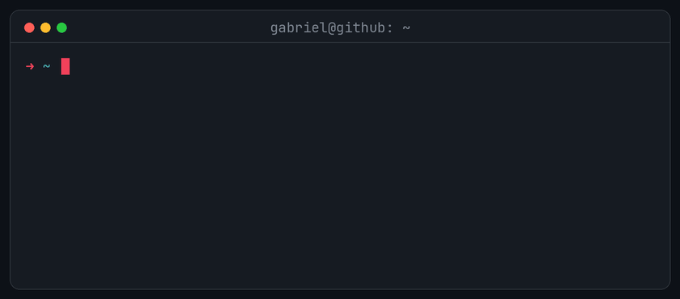
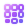
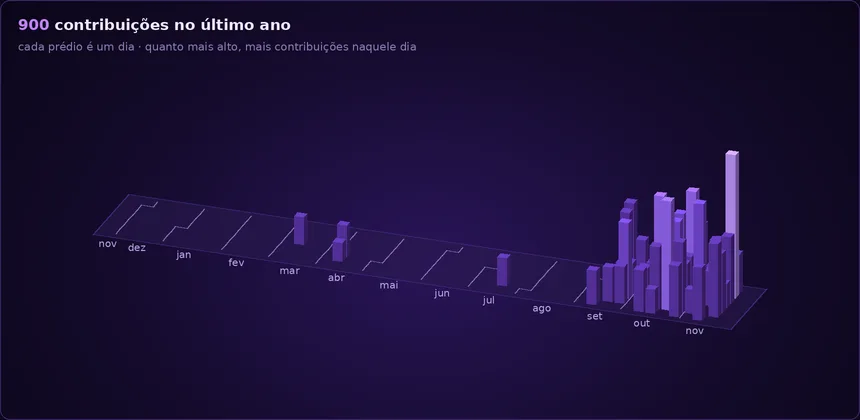

  
  
  
  

Português · <a href="#english">English below</a>

##  Sobre mim

Sou o **Gabriel Pinto Machado**, desenvolvedor full-stack em **Porto Alegre, RS**, e estudo **Ciência da Computação na Estácio**.
Desenvolvo aplicativos web e mobile, além de sistemas em tempo real, do modelo de dados à última animação. Gosto de desafios em que várias telas precisam estar sincronizadas no mesmo instante.

-  Trabalhando atualmente no **Financy** (finanças pessoais com Open Finance) e no **Órbita** (organização pessoal para iPhone)
-  Aberto a vagas CLT ou PJ (presenciais em Porto Alegre ou remotas) e a projetos freelance
-  Fale comigo pelo e-mail: [gabriel.pmachado00@gmail.com](mailto:gabriel.pmachado00@gmail.com)

<b>Como eu trabalho</b> (clique para abrir)

 

- **Estrutura antes de tudo:** camadas bem separadas, regras de acesso testadas e um projeto que outra pessoa consegue abrir e entender.
- **Fluxos que guiam:** etapas, confirmações e atalhos no lugar de formulários enormes. A interface conduz; o usuário não precisa decorar nada.
- **Nada de bagunça:** estado em um só lugar, dados sincronizados entre as telas e nada rodando à toa quando ninguém está usando.

##  Tecnologias

  
  
  
  
  
  
  
  
  
  
  
  

##  Projetos em destaque

| Projeto | O que é | Tecnologias | Link |
|---|---|---|---|
|  **Financy** | App de finanças pessoais para web e iPhone, em que as transações do Nubank e do Mercado Pago entram sozinhas via Open Finance. |    | [Ver ao vivo](https://financy-2d.web.app) |
|  **Órbita** | App de organização pessoal com módulos que podem ser ligados e desligados, captura de tarefas em linguagem natural e o visual Liquid Glass do iOS 26. |    | [Código](https://github.com/GabrielPMachado/Orbita) |
|  **HypeApp** | O "Waze do rolê": mostra em tempo real o hype de cada bar da Cidade Baixa, com notas de 0 a 10 dadas por quem já está lá. |    | [Código](https://github.com/GabrielPMachado/HypeApp) |
|  **Bar do Dindo** | Sistema completo para um bar: app de fidelidade, CRM da equipe e página de pré-cadastro, tudo em um único projeto Firebase, sem servidor próprio. |    | [Código](https://github.com/GabrielPMachado/BarDoDindo) |
|  **O Vértice** | Plataforma SaaS para pequenas empresas que reúne presença online, marketing digital e planejamento estratégico, com um carrossel 3D de templates. |    | [Ver ao vivo](https://overtice.vercel.app) |

Todos têm uma demonstração animada no <a href="https://gabrielpmachado.vercel.app">portfólio</a>.

##  Contribuições

---

<h2> English</h2>

###  About me

I'm **Gabriel Pinto Machado**, a full-stack developer in **Porto Alegre, Brazil**, studying **Computer Science at Estácio**.
I build web and mobile apps and real-time systems, from the data model to the last animation. I enjoy problems where several screens have to agree at the same moment.

-  Currently: **Financy** (personal finance with Open Finance) and **Órbita** (personal organizer for iPhone)
-  Open to full-time or contract roles, on-site in Porto Alegre or remote, and to freelance projects
-  Fastest way to reach me: [gabriel.pmachado00@gmail.com](mailto:gabriel.pmachado00@gmail.com)

<b>How I work</b> (click to open)

 

- **Structure first:** well-separated layers, tested access rules and a project someone else can open and understand.
- **Flows that guide:** steps, confirmations and shortcuts instead of huge forms. The interface leads, the user doesn't have to memorize.
- **No mess:** state in one place, data synced across screens and nothing left running when nobody is using it.

###  Tech stack

TypeScript · React · React Native · Expo · Node.js · Firebase · Swift · Python · Vite · Tailwind · Capacitor · GitHub Actions

###  Featured projects

| Project | What it is | Stack | Link |
|---|---|---|---|
|  **Financy** | Personal finance app for web and iPhone, with Nubank and Mercado Pago transactions imported automatically through Open Finance. |    | [Live](https://financy-2d.web.app) |
|  **Órbita** | Modular personal organizer for iPhone, with natural-language task capture and the iOS 26 Liquid Glass look. |    | [Code](https://github.com/GabrielPMachado/Orbita) |
|  **HypeApp** | The "Waze for nights out": a real-time hype score for every bar in Cidade Baixa, rated from 0 to 10 by the people already there. |    | [Code](https://github.com/GabrielPMachado/HypeApp) |
|  **Bar do Dindo** | Complete system for a bar: loyalty app, staff CRM and sign-up page, all in a single Firebase project with no server of its own. |    | [Code](https://github.com/GabrielPMachado/BarDoDindo) |
|  **O Vértice** | SaaS platform for small businesses that combines online presence, digital marketing and strategic planning, with a 3D template carousel. |    | [Live](https://overtice.vercel.app) |

Every project has an animated demo on my <a href="https://gabrielpmachado.vercel.app/en/">portfolio</a>.

###  Contributions

